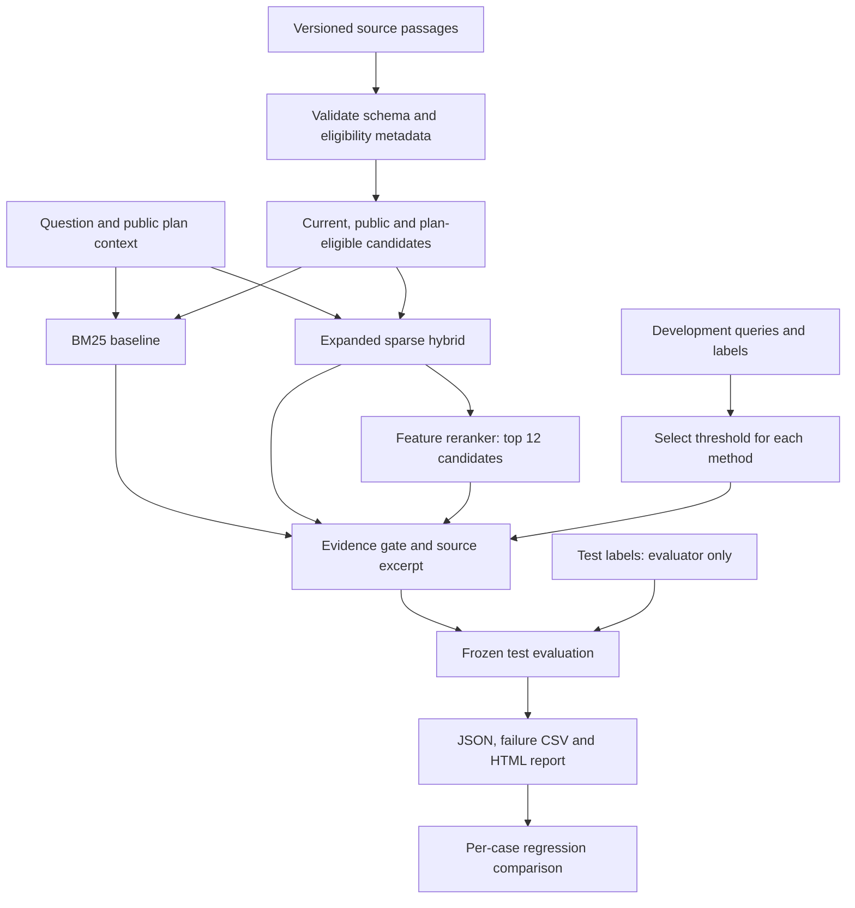

# Architecture and evaluation boundaries

The workbench separates retrieval, answer decisions and evaluation labels. It runs locally using Python 3.10+ and the standard library. The portable HTML report contains a frozen result payload; arbitrary queries run through the loopback API.

| Layer | Input and implementation | Output / boundary |
|---|---|---|
| Fixture validation | 48 source passages; 96 queries; stable IDs, gold spans, plan rules, intent groups | Reject duplicate questions, split-group overlap and ineligible gold sources |
| Eligibility | Current/public/plan metadata, identical for all methods | Archived/internal/ineligible passages excluded from ranked hits. A public plan selector is a demo context, not authenticated tenant access |
| Baseline | Raw query; BM25 k1=1.5, b=0.75, title + body | Top-five source IDs |
| Sparse hybrid | Frozen domain vocabulary; BM25 + character-trigram TF-IDF; reciprocal-rank fusion, constant 60 | Candidate ranking without embeddings |
| Feature reranker | Top 12 hybrid candidates; fixed coverage, title, trigram and fusion features | Alternative ordering without neural cross-encoder |
| Answer gate | Lexical support heuristic; development-selected threshold per method | Complete source excerpt with ID, or abstention; no generated completion |
| Evaluation | Test labels supplied only after retrieval; retrieval metrics, answer proxy, coverage and eligibility checks | Per-case evidence, aggregate results and intent-cluster bootstrap intervals |
| Reproduction check | Reference and rerun benchmark, same data fingerprints | Non-zero exit on changed thresholds, metrics, source order, citations, answers, decisions or engineering checks; timing ignored |
| Client response adapter | One JSONL response per test query, externally produced | Citation/eligibility/span checks. Semantic support needs human review |

## Information flow

`SearchIndex` receives source passages and the frozen domain vocabulary. It never receives query relevance labels or expected answer spans. Evaluation questions may query the index, but are not indexed as documents. Source passages are intentionally shared across splits for a fixed-corpus task. Intent groups, rather than passages, separate development from test questions.

## Extension to a client system

Replace the fictional fixture in a separate project copy. Agree relevance labels, source permissions and processing location first. Export retrieval IDs and actual generated answers from the client's existing stack, retaining model/prompt/index version and a run ID. This release scores external answers through the JSONL contract; full external retrieval-trace ingestion, live-provider calls, cost accounting and multi-agent/tool traces are future integrations. No API key is embedded or requested by the demo.
